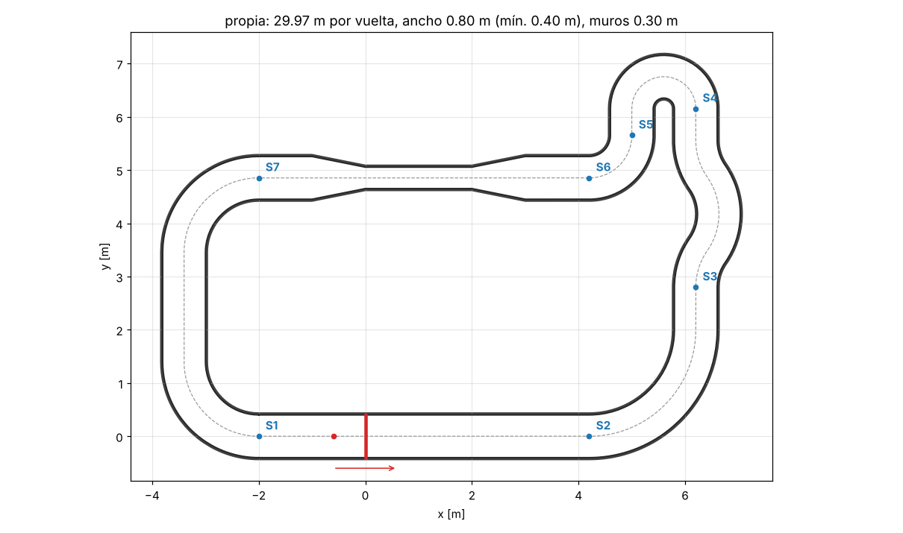

# Robot diferencial MicroROS — AEB, seguimiento de pared y competencia

Robot **MicroROS de Yahboom** (4 ruedas, *skid-steer*, LiDAR MS200) simulado en **ROS 2 Jazzy + Gazebo Harmonic**,
con dos modos de operación (teleoperado y autónomo por seguimiento de pared), **frenado autónomo de emergencia (AEB)
por tiempo a la colisión** siempre activo, odometría en varias vueltas y una pista propia diseñada en CAD.

- **Autores:** Jaime Landinez, Juan David Botero
- Curso de Robótica — Ingeniería Mecatrónica, Universidad EIA



## Resultados en Gazebo (3 vueltas, modo autónomo, tiempo de simulación)

| Pista | Vuelta 1 | Vuelta 2 | Vuelta 3 | **Total** | Contactos | Frenados del AEB | Holgura mín. (LiDAR) |
|---|---|---|---|---|---|---|---|
| Propia (29.97 m) | 31.50 s | 31.62 s | 31.59 s | **94.71 s** | 0 | 0 | 8.4 cm |
| Réplica de la de competencia (37.2 m) | 37.47 s | 37.50 s | 37.49 s | **112.46 s** | 0 | 0 | 8.0 cm |

Prueba del AEB con una caja de 0.20 m en la recta principal (x = 4 m) a 1 m/s: frena a TTC = 0.50 s
(umbral 0.52 s), **se detiene a ~27 cm de la caja y se queda quieto** mientras la caja esté ahí; al retirarla
sigue solo. En teleoperación, dirigido a 1 m/s contra el muro de la curva S2, se detiene a ~0.3 m del muro.
Figuras en [`src/robot_diferencial/docs/resultados/`](src/robot_diferencial/docs/resultados).

## Contenido

| Paquete | Qué contiene |
|---|---|
| `robot_diferencial` (ament_cmake) | `urdf/diferencial.urdf.xacro` (MicroROS), `launch/simulacion.launch.py` (un solo launch), `launch/obstaculo.launch.py`, `worlds/` + `models/` (pistas STL), `cad/` (STEP y DXF), `config/seguidor_pared.yaml`, `rviz/`, `tools/` (generador de pistas, simulador 2D, pruebas) |
| `diferencial_control` (ament_python) | nodos `cinematica_diferencial`, `mux_cmd`, `aeb`, `seguidor_pared`, `vueltas`; script `analizar_odometria`; lógica pura (`aeb.py`, `seguidor_pared.py`, `vueltas.py`, `cinematica.py`) con pruebas en `test/` |

## Instalación y ejecución

ROS 2 **Jazzy** + Gazebo **Harmonic** (Ubuntu 24.04):

```bash
sudo apt install ros-jazzy-ros-gz ros-jazzy-xacro ros-jazzy-robot-state-publisher ros-jazzy-tf2-ros \
                 ros-jazzy-rviz2 ros-jazzy-teleop-twist-keyboard python3-numpy python3-matplotlib xterm
# Terminal limpia
source /opt/ros/jazzy/setup.bash
cd ros2_ws_diferencial            # carpeta con src/
colcon build --symlink-install
source install/setup.bash
```

`xterm` es para que el launch abra el teclado de teleoperación en su propia ventana (también sirve `gnome-terminal`).

```bash
# Teleoperado en la pista propia (abre una ventana con teleop_twist_keyboard)
ros2 launch robot_diferencial simulacion.launch.py modo:=teleop pista:=propia

# Autónomo (seguimiento de pared) en la pista propia
ros2 launch robot_diferencial simulacion.launch.py modo:=auto pista:=propia

# Pista de competencia (ver "Día de la competencia")
ros2 launch robot_diferencial simulacion.launch.py modo:=auto   pista:=competencia
ros2 launch robot_diferencial simulacion.launch.py modo:=teleop pista:=competencia

# Prueba del AEB: con la simulación corriendo, en otra terminal
ros2 launch robot_diferencial obstaculo.launch.py x:=4.0 y:=0.0
```

Otros argumentos: `gui:=false` (Gazebo sin ventana), `rviz:=false`, `camara:=false` (ahorra render),
`n_vueltas:=3`, `x:= y:= yaw:=` (pose inicial; por defecto −0.60, 0, 0), `mundo:=<world.sdf>`,
`b_odometria:=0.134` (vía del nodo de cinemática), `salida:=<carpeta>`.
El modo también se puede cambiar en caliente: `ros2 param set /mux_cmd modo auto`.

Cada corrida guarda sus datos en `~/resultados_robot_diferencial/<fecha>_<pista>_<modo>/`
(`vueltas.csv`, `trayectoria.csv`, `cinematica.csv`, `aeb.csv`, `seguidor.csv`). Para las figuras del pitch:

```bash
ros2 run diferencial_control analizar_odometria ~/resultados_robot_diferencial/<carpeta>
```

Al terminar las 3 vueltas, el nodo `vueltas` imprime la tabla de tiempos y errores de cierre y, en modo
autónomo, el robot se detiene.

### Día de la competencia

1. Copiar el paquete `pista_competencia` del profesor dentro de `src/` y compilar (`colcon build --symlink-install`).
   El launch lo encuentra solo (`worlds/*.sdf` o `*.world`) y agrega sus carpetas a `GZ_SIM_RESOURCE_PATH`.
   Si no está compilado, usa la **réplica de pruebas** y lo avisa; también se puede dar `mundo:=<ruta>`.
2. Si el world del profesor no declara el sistema `Sensors` (necesario para el LiDAR `gpu_lidar`), el launch escribe
   una copia `<world>_con_sensores.sdf` con los sistemas que falten y lo avisa.
3. El robot aparece en x = −0.60, y = 0, ψ = 0, detrás de la línea x = 0, como pide el enunciado.

## Arquitectura

```
                    /scan (LiDAR MS200, 10 Hz)                          /ground_truth (pose real)
                        │            │                                        │
/cmd_vel_teleop ─┐      ▼            ▼                                        ▼
 (teclado)       ├─► mux_cmd ─► /cmd_vel_mux ─► aeb ─► /cmd_vel ─► DiffDrive  vueltas ─► tiempos, cierre,
/cmd_vel_auto ───┘   (modo)                   (TTC)                (Gazebo)    ▲          /carrera/terminada
 (seguidor_pared)                                                  │           │
                                         /joint_states (4 ruedas) ─┴─► cinematica_diferencial ─► /odom_cinematica
```

- El **AEB es el último eslabón** antes de `/cmd_vel`: ninguna fuente (teclado o seguidor) llega al robot sin pasar
  por él. Si deja de llegar `/scan` por más de 0.5 s, manda velocidad cero (falla segura).
- `mux_cmd` elige la fuente según `modo` y recorta a los límites del robot (1 m/s, 4 rad/s).
- Bridge: `/clock`, `/cmd_vel` (ROS→Gz), `/odom`, `/ground_truth`, `/tf`, `/joint_states`, `/scan`, cámara.
  `/joint_states` tiene nombre fijo (`<topic>` del plugin), así que funciona con cualquier world (antes dependía
  del nombre del world y se habría roto en la pista del profesor).
- RViz (`world` como marco fijo) muestra las trayectorias real, estimada y del DiffDrive (`/ruta/*`).

## 1. Adaptación al MicroROS (`diferencial.urdf.xacro`)

| Parámetro | Valor en el modelo | Cómo se obtiene |
|---|---|---|
| L × A × H | 198.6 × 153 × 124.2 mm | chasis de 198.6 mm de largo; 153 = vía + ancho de rueda; 124.2 = techo del LiDAR |
| Masa | 0.906 kg | ruedas 4 × 0.030, LiDAR 0.060, cámara 0.020 y el **chasis es el resto** (0.706): la suma es exacta |
| Rueda | Ø 49 mm, ancho 19 mm | ancho = 153 − 134 |
| Vía / entre ejes | 134 / 96 mm | ruedas en (±48, ±67) mm respecto a `base_link` (centro de las 4 ruedas) |
| Tracción | **skid-steer**: `DiffDrive` con dos `left_joint` y dos `right_joint` | `wheel_separation` = 0.134, `wheel_radius` = 0.0245 (mismas propiedades xacro) |
| Motores | 450 rpm, 4 kg·cm | `<limit velocity="47.1" effort="0.392">` en las juntas |
| Límites | v ≤ 1.0 m/s, ω ≤ 4.0 rad/s, a ≤ 2.0 m/s² | en el plugin; aceleración angular 2a/b = 29.9 rad/s² (misma aceleración tangencial en la banda de cada lado) |
| LiDAR MS200 | 360°, **450 muestras**, 0.03–12 m, 10 Hz, σ = 0.01 m, plano a 108 mm | 450 rayos distintos: `max_angle` = π − 2π/450 (sin duplicar ±180°) |
| Pose real | plugin `OdometryPublisher` → `/ground_truth` (marco `world`) | referencia del error de odometría |

La inercia de cada cuerpo es la del sólido uniforme correspondiente (caja, cilindro). La cámara del reporte
anterior se conserva (640×480 a 30 FPS) y se puede apagar con `camara:=false`.

## 2. Odometría en varias vueltas

El nodo `cinematica_diferencial` del reporte anterior ahora toma **ωD = media(del_der, tras_der)** y
**ωI = media(del_izq, tras_izq)**, calcula `u = A w` (v = r(ωD+ωI)/2, ω = r(ωD−ωI)/b) e integra
`q̇ = J(θ) u` por punto medio. `q(0)` es la pose real inicial, así que estimada y real están en el mismo marco
y el **error de cierre** de cada vuelta es directamente `pose estimada − pose real` en el instante en que el robot
cruza la meta (el nodo `vueltas` interpola ese instante).

**Hallazgo principal — vía efectiva del skid-steer.** Con la vía geométrica b = 0.134 m la odometría
sobrestima el giro: al girar, las ruedas de un skid-steer **deslizan lateralmente** y el robot gira menos de lo
que predicen las ruedas. Midiendo en Gazebo, la razón χ = ω_ruedas/ω_real es ≈ 1.6 girando en el sitio y ≈ 1.2
avanzando; ajustada por mínimos cuadrados con la vuelta 1 da χ = 1.46–1.48 (en las dos pistas), es decir
**b_ef = χ·b ≈ 0.197 m** (Mandow et al., 2007; Martínez et al., 2005). Errores de cierre (pista de competencia):

| Vuelta | b = 0.134 m (geométrica) | DiffDrive `/odom` | b_ef = 0.199 m (calibrada con la vuelta 1) |
|---|---|---|---|
| 1 | 853 cm, 163° | 854 cm, 163° | **47 cm, −2.2°** |
| 2 | 256 cm, −35° | 256 cm, −35° | **100 cm, −4.9°** |
| 3 | 774 cm, 127° | 774 cm, 127° | **153 cm, −12.1°** |

Lectura para el pitch:
- Con b geométrica el error de rumbo crece ≈ (χ − 1)·360° ≈ 165–175° por cada vuelta (medido: 160–163°), así que la trayectoria
  estimada "gira de más" y el error de posición no es monótono (sube y baja según hacia dónde apunte el rumbo
  equivocado). El DiffDrive comete **el mismo** error porque usa el mismo modelo (mismas b y r).
- Con b_ef el error crece de forma aproximadamente **lineal con la distancia** (~50 cm por vuelta ≈ 1.4 %
  de lo recorrido): queda el error de un modelo con χ constante cuando en realidad χ depende de la curvatura,
  y el rumbo, una vez equivocado, convierte cada metro recorrido en error lateral (error de odometría sin
  corrección externa = acumulativo; ninguna vuelta lo "reinicia").
- Para comparar en vivo: `b_odometria:=0.197`. Figuras: `docs/resultados/propia_odometria_*.png`.

## 3. AEB por tiempo a la colisión (`aeb.py`, nodo `aeb`)

Para cada rayo i: `ṙ_i = −v cos θ_i`, `TTC_i = r_i / max(−ṙ_i, 0)`; se frena si `min_i TTC_i < umbral`.

Dos refinamientos que **no cambian la fórmula** pero evitan los frenados falsos:
1. **Contorno del robot.** r_i se mide desde el LiDAR, pero lo que choca es el borde del robot:
   se usa `r_i − d_contorno(θ_i)` (distancia del LiDAR al rectángulo 198.6 × 153 mm por ese rayo; ~10 cm al frente).
2. **Franja de barrido.** Solo cuentan los puntos que el robot va a barrer con el comando actual: la franja de
   ancho 153 mm + 1.5 cm siguiendo el arco de radio R = v/ω. Un muro paralelo (estrechamiento de 0.40 m:
   quedan 12 cm a cada lado) o el muro exterior de una curva que el robot ya está tomando quedan fuera; un
   obstáculo en la trayectoria, dentro.

**Umbral (depende de la velocidad):** `umbral(v) = |v|/(2·a_f) + t_lat + t_m`
- `|v|/(2 a_f)`: es el TTC que corresponde a la distancia de frenado v²/(2a_f) recorrida a velocidad v.
  a_f = 1.6 m/s² (80 % de los 2.0 m/s² del plugin, margen por deslizamiento).
- `t_lat = 0.12 s`: edad máxima del barrido (1/10 Hz) + transporte por el bridge.
- `t_m = 0.10 s`: margen para el ruido (σ = 1 cm) y la discretización.
- A 1 m/s el umbral es 0.53 s (frena a ~0.53 m del contorno y se detiene a ~0.25 m); a 0.3 m/s, 0.31 s.

**Prioridad y retención.** El AEB va después del mux, así que vale para los dos modos. Mientras el comando
insista en avanzar hacia el obstáculo, el robot queda detenido (v = 0, ω = 0); girar en el sitio o retroceder sí
se permite (para salir en teleoperación). El freno se suelta solo cuando el camino está libre **para avanzar a
v_max** (con histéresis 1.3 y mínimo 0.5 s): así el robot no se "arrastra" hasta el obstáculo cuando el comando
baja la velocidad, y continúa solo cuando se retira el obstáculo. La velocidad para el TTC es la mayor (en
magnitud) entre la comandada y la medida si van en el mismo sentido.

Validación: 6 vueltas completas en Gazebo (dos pistas) **sin un solo frenado** (el mín TTC en curvas,
chicana, horquilla y estrechamiento fue 0.74 s, contra un umbral de 0.53 s); detención frente a la caja y frente al muro. `docs/resultados/aeb_obstaculo_recta.png`.

## 4. Seguimiento de pared con PID (`seguidor_pared.py`, nodo `seguidor_pared`)

Muro izquierdo (interior en la pista antihoraria): rayo **b a +90°**, rayo **a a +45°** (θ = 45°):

```
α = arctan((a cos θ − b) / (a sin θ)),  D_t = b cos α,  D_t+1 = D_t + l sin α,  e = D_des − D_t+1,  ω = −PID(e)
```

Cada rayo es la **mediana de 5 rayos** (±1.6°), que rechaza el ruido de 1 cm sin retrasar la medida.

**Sintonización por modelo.** Con ángulos pequeños, d = distancia al muro: ḋ = vα, α̇ = −ω y
ω = −Kp(D_des − d − lα) ⇒ `d̈ + Kp·l·ḋ + v·Kp·d = v·Kp·D_des`, o sea **ωn = √(v·Kp)** y
**ζ = (l/2)·√(Kp/v)**: la anticipación l hace de término derivativo. Con **Kp = 10, l = 0.45 m** a v = 1 m/s:
ωn = 3.2 rad/s y ζ = 0.71. Como el skid-steer gira χ ≈ 1.2–1.6 veces menos de lo pedido, la ganancia efectiva
es Kp/χ (ζ ≈ 0.56–0.65): por eso Kp no se bajó más. ωn·T = 0.32 con T = 0.1 s (LiDAR a 10 Hz): el muestreo
no domina la dinámica. **Ki = 0.3** corrige sesgos lentos (asimetrías, deslizamiento) con anti-windup
(integración condicional + |∫e| ≤ 0.3); **Kd = 0.3** con derivada filtrada (τ = 0.1 s) da amortiguamiento extra
frente al retardo del barrido. Se barrieron Kp ∈ {5…10}, l ∈ {0.45, 0.6}, D_nom, lado, χ ∈ {1.0, 1.3, 1.7},
latencia y semillas de ruido en el simulador 2D (`tools/sim2d.py`); la combinación elegida no tuvo fallos en
ningún caso.

**D_des adaptativa:** `D_des = min(D_nom, W/2)` con `W = D_izq,t+1 + D_der,t+1` medido con los mismos dos rayos
en cada lado. Con D_nom = 0.40 m en una pista de 0.80 m el robot va **centrado**, y en el estrechamiento de 0.40 m
sigue centrado (12 cm por lado) sin ningún caso especial. Usar D_t+1 (proyectada) en W hace que el robot "vea"
venir el estrechamiento: con la distancia actual el robot se torcía al entrar y el AEB (correctamente) lo frenaba.

**Velocidad según la curvatura:** `v = min(v_max, a_lat/|ω|, √(2·a·(d_frente − 0.30)))` con a_lat = 1.2 m/s²
(curvatura κ = ω/v ⇒ aceleración lateral v·ω) y rampa de subida de 2 m/s². En la horquilla de la pista propia
baja a ~0.3–0.6 m/s; en la pista de competencia casi todo se recorre a 1 m/s (radios ≥ 1 m).

## 5. Pista propia (`tools/pistas.py`, `tools/generar_pistas.py`)

Circuito cerrado antihorario de **29.97 m**, ancho 0.80 m, muros de 0.30 m de alto y 5 cm de espesor:

| Sección | Diseño | Para qué |
|---|---|---|
| S1 recta principal | 6.2 m, salida/meta en x = 0 | arranque en x = −0.60 |
| S2 curva amplia | 90°, R = 2.0 m | velocidad alta en curva |
| S3 chicana | R = 1.2 m: −35°, +70°, −35° | cambios de curvatura rápidos |
| S4 horquilla | 180°, R = 0.6 m (muro interior R 0.2 m) | curvatura máxima: obliga a bajar la velocidad |
| S5 curva cerrada **a la derecha** | 90°, R = 0.8 m | el muro seguido pasa a ser el exterior |
| S6 estrechamiento | 0.40 m durante 2.0 m, transiciones de 1.0 m | igual al de la competencia |
| retorno | dos curvas medias de 90°, R = 1.4 m | cierra el circuito |

**CAD:** la geometría es paramétrica (tramos + perfil de ancho) y se construye con **CadQuery/OpenCascade**:
`cad/pista_propia.step` (sólido, se abre en Fusion/SolidWorks) y `cad/pista_propia_planta.dxf` (planta).
La malla **STL en metros** (`models/pista_propia/meshes/pista_propia.stl`, estanca: cada arista en 2 triángulos)
se importa como `<mesh>` con **colisión**; la línea de meta es una franja a cuadros en x = 0.
El generador verifica: cierre del lazo (< 1 mm), giro total 360°, ancho mínimo ≥ 0.40 m, que el muro interior no se
auto-intersecte y la separación entre tramos vecinos. Regenerar: `python3 tools/generar_pistas.py`.

`pista_competencia_replica` es una copia de la Fig. 1 del enunciado (37.21 m, mismas secciones y radios) **solo
para pruebas**; en la competencia se usa el paquete del profesor.

## Validación

```bash
cd src/diferencial_control && python3 -m pytest test -q     # 23 pruebas: TTC, franja, retención, α, PID, vueltas
cd src/robot_diferencial && python3 -m pytest tools -q       # pistas (cierre, ancho, STL estanco) y modelo (masa, límites)
python3 tools/sim2d.py --pista competencia --figura /tmp/c.png   # simulador 2D (sin Gazebo) para sintonizar
```

Además, corridas completas en Gazebo Harmonic (resultados arriba), incluida una prueba con un paquete
`pista_competencia` de imitación cuyo world no declara plugins.

## Cambios y correcciones respecto al reporte anterior

- `/joint_states` dependía del nombre del world (`/world/pista/...`): en la pista del profesor la cinemática se
  habría quedado sin datos. Ahora el plugin publica en `/joint_states` directamente.
- La cinemática se comparaba con el `/odom` del DiffDrive (consistencia entre dos estimadores, no error real).
  Ahora se compara con la pose real del simulador.
- `teleop_twist_keyboard` publicaba directo en `/cmd_vel`, sin ninguna capa de seguridad.
- `setup.py` usaba `tests_require` (obsoleto; falla con setuptools recientes) → `extras_require`.
- Pista del reporte anterior (393 cajas) reemplazada por la pista propia en STL; robot de 2 ruedas + caster
  reemplazado por el MicroROS.

## Referencias

- R. Siegwart, I. Nourbakhsh, D. Scaramuzza, *Introduction to Autonomous Mobile Robots*, 2.ª ed., MIT Press, 2011 (cap. 3, cinemática).
- F1TENTH, Univ. of Pennsylvania: *Lab: Automatic Emergency Braking* y *Lab: Wall Following* (TTC por rayo y geometría de dos rayos).
- A. Mandow et al., "Experimental kinematics for wheeled skid-steer mobile robots", IEEE/RSJ IROS, 2007.
- J. L. Martínez et al., "Approximating kinematics for tracked mobile robots", *Int. J. Robotics Research* 24(10), 2005.
- K. J. Åström, R. M. Murray, *Feedback Systems*, Princeton University Press, 2008 (PID, anti-windup, filtro derivativo).
- Gazebo Sim (Harmonic): sistemas `DiffDrive`, `JointStatePublisher`, `OdometryPublisher`, `Sensors`.
- Yahboom MicroROS / Oradar MS200: hojas de datos del fabricante (medidas de la tabla 3.1 del enunciado).
