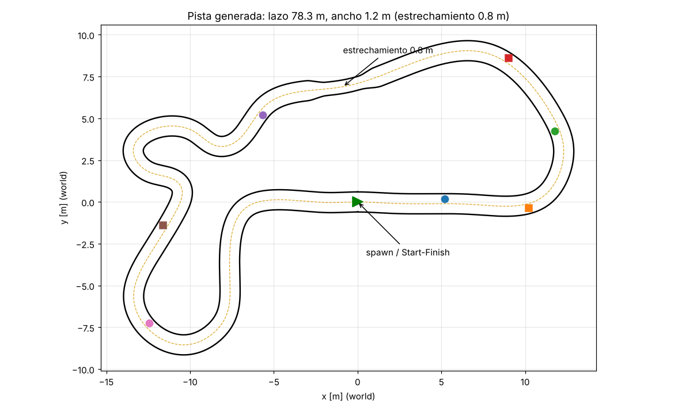

# Robot diferencial en Gazebo — pista propia, LiDAR y cámara

Reporte de Robótica (Universidad EIA). Robot móvil de **tracción diferencial** (2 ruedas motrices + caster)
simulado en **ROS 2 Jazzy + Gazebo Harmonic**, con LiDAR 2D y cámara, que recorre una pista diseñada por
el equipo con `teleop_twist_keyboard`.

- **Autores:** Jaime Landinez (jaime.landinez@eia.edu.co) · `[COMPLETAR integrantes]`
- **Grupo / entrega:** `[COMPLETAR GXX_PI_AVYY]`
- **Notion (modelo, cinemática, parámetros y decisiones):** `[COMPLETAR enlace]` — texto base en [`docs/NOTION_contenido.md`](docs/NOTION_contenido.md)



## Contenido

| Paquete | Qué contiene |
|---|---|
| `robot_diferencial` (ament_cmake) | `urdf/diferencial.urdf.xacro`, `worlds/pista.sdf`, `launch/simulacion.launch.py`, `rviz/control.rviz`, `tools/generar_pista.py` |
| `diferencial_control` (ament_python) | nodo `cinematica_diferencial` (w → u → q̇, integra la pose y la compara con `/odom`), pruebas en `test/` |

## Dependencias

ROS 2 **Jazzy** + Gazebo **Harmonic** (Ubuntu 24.04):

```bash
sudo apt install ros-jazzy-ros-gz ros-jazzy-xacro ros-jazzy-robot-state-publisher \
                 ros-jazzy-rviz2 ros-jazzy-teleop-twist-keyboard python3-numpy
```

Solo para regenerar la pista (opcional): `python3-scipy python3-matplotlib`.

## Compilar y ejecutar

```bash
# Terminal limpia
source /opt/ros/jazzy/setup.bash
cd ros2_ws_diferencial
colcon build --symlink-install
source install/setup.bash

# Terminal 1: Gazebo + pista + robot + bridge + cinemática + RViz2 (un solo launch)
ros2 launch robot_diferencial simulacion.launch.py

# Terminal 2: teleoperación (en esta terminal se escriben las teclas)
source /opt/ros/jazzy/setup.bash && source install/setup.bash
ros2 run teleop_twist_keyboard teleop_twist_keyboard
```

Teclas: `i` avanzar, `,` retroceder, `j`/`l` girar, `u`/`o` avanzar girando, `k` parar, `q`/`z` subir/bajar velocidades.
Se recomienda ~0.4 m/s y ~0.8 rad/s en la pista.

Argumentos del launch: `rviz:=false` (sin RViz) y `csv:=/tmp/odometrias.csv` (guarda ambas odometrías para el análisis del error).

### Verificación rápida

```bash
ros2 topic list                                   # /cmd_vel /odom /tf /joint_states /scan /camera/image_raw /camera/camera_info ...
ros2 topic hz /scan                               # ~10 Hz
ros2 topic hz /camera/image_raw                   # ~30 Hz
ros2 topic echo /camera/camera_info --once        # frame_id: camara_optica_link
ros2 run tf2_tools view_frames                    # odom -> base_link -> {rueda_izq, rueda_der, caster_link, lidar_link, camara_link -> camara_optica_link}
ros2 topic echo /error_odometria                  # [e_x, e_y, e_pos, e_theta, distancia]
gz topic -l | grep -E "camera|scan|odom|tf"       # nombres de topics en Gazebo (si algo no llega a ROS)
```

Pruebas de la cinemática (no necesitan Gazebo):

```bash
cd src/diferencial_control && python3 -m pytest test -q
```

## Modelo del robot (`diferencial.urdf.xacro`)

Parametrizado por `rueda_radio` y `separacion_ruedas`; el resto (caster, plugin DiffDrive) se calcula a partir de ellos.
`base_link` está en el punto medio del eje de las ruedas (REP-103: x adelante, y izquierda, z arriba).

| Parámetro | Valor | Justificación |
|---|---|---|
| Radio de rueda `r` | 0.05 m | Rueda pequeña típica de plataformas educativas; con `v_max = 1 m/s` pide ω = 20 rad/s, razonable para un motor DC con reductora |
| Separación `b` | 0.30 m | Ancho total = `b` + ancho de rueda = 0.34 m, que deja ≥ 0.70 m libres en el estrechamiento de 0.8 m |
| Chasis | 0.34 × 0.20 × 0.08 m, 2.0 kg | Cabe entre las ruedas (0.30 − 0.04 = 0.26 m); inercia de caja uniforme `I = m(a²+b²)/12` |
| Ruedas | cilindro r=0.05, ancho 0.04, 0.15 kg | Inercia de cilindro con eje en y: `Iyy = mr²/2`, `Ixx = Izz = m(3r²+h²)/12`; fricción μ=1 |
| Caster | esfera r=0.025, μ≈0, al frente (x = 0.17) | Tercer apoyo sin fricción; el chasis se desplaza 3 cm hacia el caster para que el CG quede delante del eje (no vuelca hacia atrás) |
| Colisiones | cajas/cilindros/esferas simples | Menor costo y contacto estable (misma geometría que lo visual) |

### Tracción diferencial (plugin `DiffDrive`)

`wheel_separation = 0.30` y `wheel_radius = 0.05` salen de las mismas propiedades xacro del modelo (no hay valores “mágicos”).
Publica `/odom` (frame `odom` → `base_link`) y el TF `odom → base_link`; recibe `/cmd_vel`.
Límites: `v ≤ 1 m/s`, `ω ≤ 3 rad/s`, aceleraciones 2 m/s² y 6 rad/s² (arranques suaves con teclado).

## Cinemática de las llantas (`diferencial_control`)

Con `w = [ωD, ωI]ᵀ`, `u = [v, ω]ᵀ`, `q = [x, y, θ]ᵀ`:

```
u = A w ,   A = [ r/2   r/2 ]          v = r(ωD + ωI)/2
                [ r/b  -r/b ]          ω = r(ωD − ωI)/b

q̇ = J(θ) u ,   J(θ) = [cosθ 0; sinθ 0; 0 1]      ⇒   q̇ = J(θ) A w
inversa (la usa DiffDrive con /cmd_vel):  ωD = (v + ωb/2)/r ,  ωI = (v − ωb/2)/r
```

El nodo `cinematica_diferencial`:

1. lee `ωD, ωI` de `/joint_states` (velocidades de `joint_rueda_der` / `joint_rueda_izq`);
2. calcula `u = A w` y `q̇ = J(θ)u`, e integra `q` (método del punto medio, orden 2; `-p metodo:=euler` para comparar);
3. publica `/odom_cinematica` (sin TF, para no chocar con el de DiffDrive);
4. compara con `/odom` **en el mismo instante** (interpola su pose en el sello de tiempo de cada `/odom`) y publica el error en `/error_odometria`
   = `[e_x, e_y, ‖e_p‖, e_θ, distancia recorrida]`, con un resumen al terminar (media/máx/final y % de la distancia).

`q(0)` se toma de la primera lectura de `/odom`; arranque el nodo con el robot quieto (el launch ya lo hace).

**Origen esperado de las diferencias** (para el análisis del reporte): (i) discretización de la integración (Euler vs. punto medio, `dt` del bridge);
(ii) nuestro nodo usa *velocidades* de rueda mientras que DiffDrive deriva su odometría de las *posiciones* de rueda, y ambos usan sellos de tiempo/muestreos distintos;
(iii) el deslizamiento real de las ruedas en Gazebo afecta a ambos por igual (los dos asumen rodadura sin deslizamiento), por lo que el error entre ellos
**no** mide el error respecto a la pose real: para eso se compararía con la pose “ground truth” del simulador. *(Punto (ii): verificarlo leyendo el código de gz-sim `DiffDrive` antes de afirmarlo en el pitch.)*

## LiDAR y cámara

| Sensor | Parámetros | Justificación |
|---|---|---|
| LiDAR `gpu_lidar` en `lidar_link`, topic `/scan` | FOV 360°, **800 muestras** (0.45°), **10 Hz**, rango **0.15–12 m**, ruido gaussiano σ = 1 cm | Valores de la clase RPLIDAR A1 (SLAMTEC): 8000 muestras/s ÷ 10 vueltas/s = 800. 360° para ver ambos muros; 12 m cubre la recta más larga de la pista; a 0.5 m/s el robot avanza 5 cm entre barridos. Montado en el centro, por encima del chasis y de la cámara (sin auto-oclusión), a 0.13 m del suelo: ve muros (0.40 m) y obstáculos (0.50 m) |
| Cámara `camera` en `camara_link`, `/camera/image_raw` + `/camera/camera_info` | **640×480, 30 FPS**, HFOV 60° (1.047 rad), R8G8B8, clip 0.05–15 m | VGA@30 es suficiente para ver muros/obstáculos sin costo alto de render; mensajes con `frame_id = camara_optica_link` (convención óptica z adelante, x derecha, y abajo) |

## Pista (`worlds/pista.sdf`)

Diseño a partir del trazado de referencia (`docs/pista_referencia.png`): se binarizó la imagen, se esqueletizó el trazo
(línea central), se suavizó/remuestreó y se escaló a **0.08 m/px**. `tools/generar_pista.py` genera el SDF de forma reproducible:

- **Lazo de 78 m**, ~28 × 19 m, con curvas amplias, una **horquilla cerrada** (radio mínimo ≈ 0.8 m) y un tramo en “S” (rectas, curvas largas y cambios de sentido).
- **Ancho 1.20 m** (3.5× el ancho del robot) con **muros con colisión** a ambos lados (393 cajas estáticas, 0.40 m de alto).
- **Estrechamiento de 0.80 m** (2.3× el ancho del robot) en la recta superior, con transiciones suaves de 1.2 m.
- **7 obstáculos** (cilindros y cajas, 0.30 m) en zigzag que dejan ≥ 0.70 m libres.
- **Spawn** en la línea Start/Finish, origen del mundo, `yaw = 0` (tangente de la pista), sentido antihorario en el plano.
- Verificaciones del generador: radio mínimo > semiancho, separación entre tramos vecinos, huella del robot (0.42 × 0.34 m) a lo largo del eje con ≥ 22 cm de holgura, y paso libre de cada obstáculo.

Para modificar: edite los parámetros al inicio de `tools/generar_pista.py` y ejecute `python3 tools/generar_pista.py` (desde `src/robot_diferencial`).

## Estado de verificación

Hecho sin simulador (este entorno no tenía ROS ni Gazebo): XML bien formado y expansión de los macros xacro con un expansor propio
(árbol de links conexo, inercias físicamente válidas, sin expresiones sin evaluar), geometría de la pista, matemática de la cinemática (6 pruebas)
y la lógica del nodo con ROS simulado.
**Pendiente de comprobar en una máquina con ROS 2 Jazzy + Gazebo Harmonic:** `colcon build`, el arranque con `ros2 launch`, los nombres reales de topics del bridge
(sobre todo `/camera/camera_info`; el launch puentea los dos nombres posibles), el recorrido completo con teclado y el error medido entre odometrías.

## Referencias

- Siegwart, Nourbakhsh y Scaramuzza. *Introduction to Autonomous Mobile Robots*, 2.ª ed., MIT Press, 2011 — cap. 3 (cinemática de robots de ruedas).
- REP-103 (unidades y convenciones de ejes) y REP-105 (marcos de coordenadas), ROS Enhancement Proposals.
- Documentación de Gazebo Sim (sistemas `DiffDrive`, `JointStatePublisher`, sensores `gpu_lidar` y `camera`) y de `ros_gz_bridge`.
- SLAMTEC, hoja de datos RPLIDAR A1.
